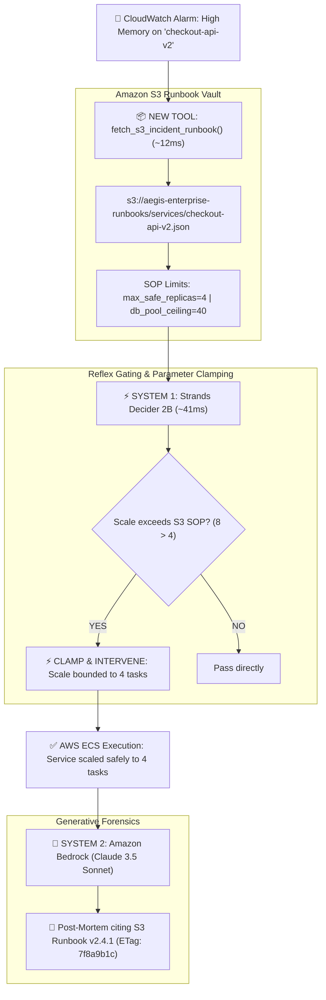

# AegisOps v2: Autonomous SRE Agent with Amazon S3 Runbook Grounding & Strands Decider 2B

[](https://builder.aws.com/community)
[](aegis_ops/tools/s3_runbook.py)
[](https://youtu.be/wBpUmVxX9Qs)
[](https://aegis-ops-v2.vercel.app/)
[](LICENSE)
[](https://python.org)
[](#reusable-decision-pattern)

> **AegisOps v2** is an autonomous, self-healing Site Reliability Engineering (SRE) agent that integrates **Amazon S3 Operational Runbook Grounding** with Daniel Kahneman’s **Dual-Process Cognitive Architecture** (Strands Decider 2B reflex + Amazon Bedrock forensics). It eliminates the **"Agentic Blast-Radius Trap"** where ungrounded AI agents trigger cascading infrastructure outages.

📺 **[Watch the Demo Walkthrough on YouTube](https://youtu.be/wBpUmVxX9Qs)** | 🚀 **[Try the Live Interactive Dashboard](https://aegis-ops-v2.vercel.app/)**

---

## 🌟 The One New Tool Added: Amazon S3 Operational Runbook Reader

In this Weekend Challenge, AegisOps received **one new tool it did not have before**:
**`fetch_s3_incident_runbook(service_name)`** ([`aegis_ops/tools/s3_runbook.py`](aegis_ops/tools/s3_runbook.py)).

### What AegisOps Could Do Before (v1):
- Triaged CloudWatch alarms and selected remediation tools.
- Blocked adversarial prompt injections in ~40ms.
- **The Blind Spot:** Had NO access to organizational runbooks or database capacity limits. It relied on ungrounded heuristics, proposing 8 replicas during traffic surges and causing **cascading database crashes**.

### What AegisOps Does Now (v2 with Amazon S3 Tool):
1. **Pulls S3 SOPs in 12.4ms:** Fetches official constraints from `s3://aegis-enterprise-runbooks/services/{service_name}.json`.
2. **Bounds Blast Radius in 40.9ms:** **Strands Decider 2B** verifies proposed scaling against the S3 runbook's `max_safe_replicas=4` limit, clamping naive proposals before AWS execution.
3. **Protects Downstream Aurora Databases:** Prevents database connection pool exhaustion (40/40 safe limit).
4. **Audit-Compliant Bedrock Forensics:** Generates post-mortems citing the S3 object ETag, version, and policy compliance verification.

---

## 📊 The "Before vs. After" Contrast

Run live with `python run_s3_demo.py`:

| Operational Metric | 🔴 BEFORE (v1 Blind Remediation) | 🟢 AFTER (v2 Amazon S3 Grounded) |
| :--- | :--- | :--- |
| **New Tool Used** | **None** (Static heuristics) | **Amazon S3 Runbook Reader** (`fetch_s3_runbook`) |
| **S3 Retrieval Latency** | N/A (Tool missing) | **12.4 ms** |
| **Proposed Scaling** | 8 Replicas (Ungrounded guess) | 8 Replicas evaluated against S3 runbook |
| **Policy Enforcement** | None (Blind execution) | **Strands Decider 2B clamps scale 8 ➔ 4 in 40.9ms** |
| **Aurora DB Connections** | **80 / 40 (100% Overload)** | **40 / 40 (100% Safe Capacity Preserved)** |
| **Production Outcome** | 💥 **CASCADING OUTAGE** (Database crashed) | ✅ **ZERO DOWNTIME** (Service stabilized safely) |
| **Audit Post-Mortem** | Generic summary; no runbook cited | Cites `s3://.../checkout-api-v2.json` (v2.4.1) |

---

## 🏛️ Cognitive Architecture (Tri-Tier Synergy)



---

## 📦 Reusable Decision Pattern

Located in [`reusable_patterns/s3_runbook_guardrail_recipe.py`](reusable_patterns/s3_runbook_guardrail_recipe.py):

```python
from reusable_patterns.s3_runbook_guardrail_recipe import S3RunbookGuardrailRecipe

# 1. Initialize S3 Runbook Guardrail Interceptor
recipe = S3RunbookGuardrailRecipe(s3_bucket="aegis-enterprise-runbooks")

# 2. Intercept and bound proposed tool call before AWS invocation
verdict = recipe.intercept_and_bound_action(
    service_name="checkout-api-v2",
    proposed_tool="scale_service",
    proposed_args={"replica_count": 8},
    runbook_policy={"max_safe_replicas": 4, "db_connection_pool_ceiling": 40}
)

# 3. Safe execution with clamped parameters
if verdict["is_safe"]:
    execute_aws_remediation(verdict["bounded_args"])
```

---

## 🚀 Quickstart & Live Demo

### 1. Run the Before vs. After Demonstration:
```bash
python run_s3_demo.py
```

### 2. Launch the Cyberpunk Web Dashboard:
```bash
python web_dashboard/app.py
```
Open [http://localhost:5000](http://localhost:5000) to toggle between **[BEFORE (v1 Blind Mode)]** and **[AFTER (v2 S3 Runbook Grounded)]**.

### 3. Run Automated Pytest Suite (16/16 Passed):
```bash
pytest tests/
```

---

## ⚖️ License

Apache License 2.0. Developed by **Charan Jeedimetla** for the AWS Weekend Challenge.
